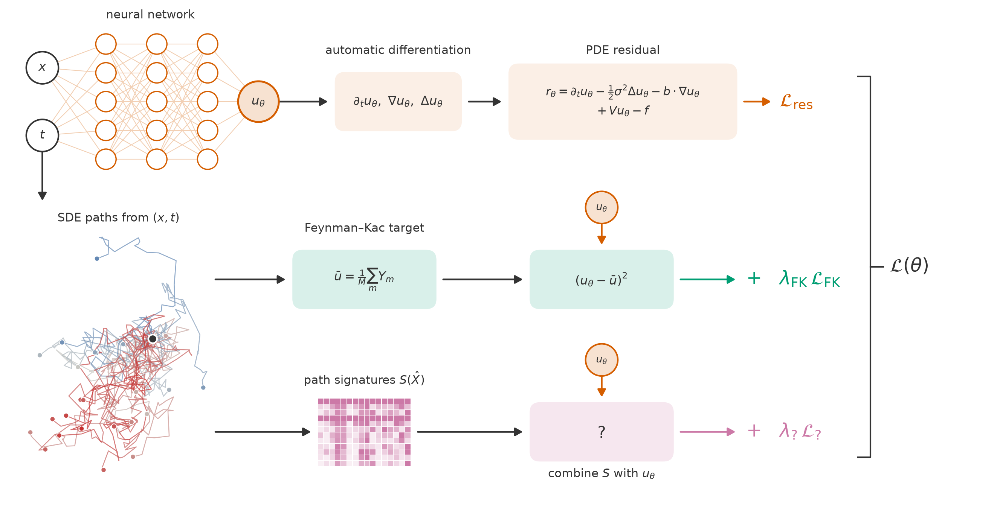
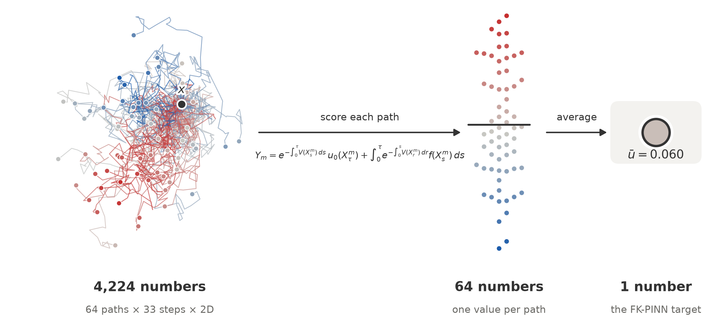

# Path-Enhanced FK-PINNs

**Stochastic physics-informed neural networks: Feynman–Kac path signatures for high-dimensional PDEs**

Federico Ganzer · IIB project, Department of Engineering, University of Cambridge

> [!NOTE]
> **Active work in progress.** This repository tracks ongoing research. Code, notation and results will change, and new work will be added here as the research goes on. Nothing in it should be read as a final result yet.

## Overview

Physics-informed neural networks (PINNs) solve PDEs without a mesh by penalising the PDE residual at sampled points (Raissi et al., 2019). They are often hard to train, because the loss inherits the ill-conditioning of the differential operator. Tepakbong et al. (2026) show that adding a small number of pointwise labels, computed by Monte Carlo from the Feynman–Kac (FK) representation of the solution, acts as a preconditioner on the loss. They call the result an *FK-PINN*.

Each FK label is built from many simulated SDE paths, but every path is reduced to a single number before averaging. This project asks whether more of each path can be used during training. The tool for this is the **path signature** (Chevyrev & Kormilitzin, 2016; Lyons & McLeod, 2025): the sequence of iterated integrals of a path, which describes it in a graded, linear form.

<p align="center">
  
</p>

**Figure 1.** The training loss. Top: the standard PINN residual, computed by automatic differentiation. Middle: FK supervision, which regresses $`u_\theta`$ onto a Monte Carlo average over SDE paths. Bottom: the question this project works on, which is how to combine the signatures $`S(\hat X)`$ of the same paths with $`u_\theta`$ to form a further loss term.

## Feynman–Kac supervision

When a linear PDE's operator $`\mathcal{L}`$ is the generator of an SDE $`dX_s = b(X_s)\thinspace ds + \sigma(X_s)\thinspace dW_s`$, the Feynman–Kac formula writes the solution at a point as an expectation over paths started from that point. Without killing or source terms,

```math
u(t,x) = \mathbb{E}\big[g(X_\tau) \mid X_t = x\big], \qquad \tau = \inf\lbrace s \ge t : X_s \notin \Omega\rbrace \wedge T .
```

With a potential $`V`$ or a source $`f`$, the same formula holds with an added discount factor and running cost, as in the figure below. An FK label at $`x`$ is the Monte Carlo average of this functional over $`M`$ Euler–Maruyama paths.

<p align="center">
  
</p>

**Figure 2.** How an FK label is formed. 64 paths of 33 steps in 2D (4,224 numbers) are each scored by the FK functional, giving 64 numbers. These are averaged into one label $`\bar u`$. Ordinary FK supervision keeps only this last number.

Related methods also train on stochastic representations of the PDE. Deep BSDE (Han, Jentzen & E, 2018) recasts parabolic PDEs as backward SDEs. The derivative-free loss method uses FK walkers inside the loss, and Han & Lee (2026) analyse its bias and trainability.

## Current approach: Signature-Hierarchy FK-PINNs

The lowest-degree term is ordinary FK supervision. Higher-degree terms add FK information carried by the path signature of each simulated path, truncated at a chosen depth $`N`$.

The PINN loss becomes

```math
\mathcal{L}(\theta) = \frac{1}{n_r}\sum_{i}\big|(\partial_t+\mathcal{L})u_\theta(\mathbf{z}_i)\big|^2 + \frac{1}{n_b}\sum_{j}\big|u_\theta(\mathbf{z}_j)-g(\mathbf{z}_j)\big|^2 + \frac{1}{n}\sum_{i}\sum_{w\in W_N}\lambda_w\big(\hat u_w(\mathbf{z}_i;\theta)-Y_{w,i}\big)^2
```

Inside the residual, $`\mathcal{L}`$ is the SDE generator. The first two terms are the classical PINN residual and boundary terms, on collocation points $`\mathbf{z}_i`$ and boundary points $`\mathbf{z}_j\in\partial\Omega`$. The last term is the FK supervision loss. Its inner sum runs over words $`w\in W_N`$ of length at most $`N`$ in the letters $`\lbrace 0,1,\dots,d\rbrace`$, where letter $`0`$ is time and letters $`1,\dots,d`$ are the Brownian coordinates. Each word has a weight $`\lambda_w \ge 0`$. The empty word $`w=\emptyset`$ recovers ordinary FK supervision, with $`\hat u_\emptyset=u_\theta`$. The target is

```math
Y_{w,i}=\frac{1}{M}\sum_{m=1}^{M}\left\langle e_w,\thickspace\check S^{(m)}_{t_i,\tau_i^{(m)}}\right\rangle\thinspace g\big(X^{(m)}_{\tau_i^{(m)}}\big), \qquad \tau_i^{(m)}=\inf\lbrace s\ge t_i: X^{(m)}_s\notin\Omega\rbrace\wedge T
```

where $`\check S`$ is the Itô signature of the time-augmented driver $`(s,W_s)`$. It is accumulated along each Euler–Maruyama path by the left-point recursion $`S_w\leftarrow S_w+S_{w^{-}}\Delta\widehat W^{a}_k`$, with $`w=w^{-}a`$, updating the longest words first.

The prediction $`\hat u_w(\mathbf{z}_i;\theta)`$ comes from the network. Each construction below adds a PSD term $`\lambda_w J_w^\top J_w`$, with $`J_w=\partial_\theta\hat u_w`$, to the Gauss–Newton matrix. The constructions differ in which parameters that curvature acts on.

### Signature heads

Split the network into a trunk $`h_\psi(\mathbf{z})\in\mathbb{R}^q`$ and linear heads, and set $`\hat u_w=c_w^\top h_\psi(\mathbf{z})`$, with $`u_\theta=c_\emptyset^\top h_\psi`$. Then $`J_w`$ is supported on $`(\psi,c_w)`$ and $`\partial\hat u_w/\partial c_\emptyset=0`$. The added curvature therefore acts only on the trunk, and the 0th-order head $`c_\emptyset`$ receives none. The cost is negligible, but nothing forces $`\hat u_w`$ to be consistent with $`u_\theta`$.

### Tied, pointwise

Express $`\hat u_w`$ as a differential operator applied to $`u_\theta`$ at the same point. With $`\tau=T-t`$, $`D_a=(\sigma^\top\nabla)_a`$ for $`a\ge1`$, $`D_0=\mathrm{id}`$ and $`n=|w|`$:

```math
\hat u_w(\mathbf{z};\theta)=\frac{\tau^{n}}{n!}\thinspace D_{a_1}\cdots D_{a_n}u_\theta(\mathbf{z}), \qquad w=a_1\cdots a_n
```

The identity is exact if and only if $`D_a u(s,X_s)`$ is a martingale, i.e. $`[\mathcal{L},D_a]=0`$. This holds for constant coefficients and, after a change of variables, for commuting vector fields (for example geometric Brownian motion in log coordinates). Affine SDEs admit the same pointwise form with matrix weights in place of $`\tau^n/n!`$. The cost is one autodiff call at $`\mathbf{z}_i`$. The added curvature $`\lambda_w\nabla_\theta(D_wu_\theta)\nabla_\theta(D_wu_\theta)^\top`$ acts on all parameters of $`u_\theta`$, through derivative features.

### Tied, path-integrated

For general $`b,\sigma`$ no pointwise identity exists. At level one, $`u_a(t,x)=\mathbb{E}\big[\int_t^{\tau}(\sigma^\top\nabla u)_a(s,X_s)\thinspace ds\big]`$, so $`\hat u_a`$ is estimated on a stored path set $`\lbrace X'^{(m)}\rbrace`$ that is independent of the one behind $`Y`$:

```math
\hat u_a(\mathbf{z}_i;\theta)=\frac{1}{M'}\sum_{m=1}^{M'}\sum_{k}\big(\sigma^\top\nabla u_\theta\big)_a\big(s_k,X'^{(m)}_{s_k}\big)\thinspace\Delta s_k
```

This needs $`M'K`$ network-gradient evaluations per point and storage $`n\times M'\times K\times d`$. Because $`\mathrm{Var}(\hat u_a)`$ depends on $`\theta`$, the minimiser is biased by $`O(1/M')`$ (double sampling). Levels $`\ge 2`$ require nested estimators. The added curvature acts on all parameters of $`u_\theta`$, through gradient features evaluated along the path.

### Comparison

| Construction | Ties $`\hat u_w`$ to $`u_\theta`$ | Added curvature acts on | Cost per point |
|---|---|---|---|
| Signature heads | No | Trunk $`\psi`$ and head $`c_w`$ only | Negligible |
| Tied, pointwise | Yes, exact iff $`[\mathcal{L},D_a]=0`$ | All parameters, via derivative features | One autodiff call |
| Tied, path-integrated | Yes, for general $`b,\sigma`$ (level 1) | All parameters, via gradient features along paths | $`M'K`$ gradient evaluations, $`O(1/M')`$ bias |

## Also under investigation: signature control variates

The FK label is a Monte Carlo average, so its noise limits how much FK supervision can help. Some coordinates of the driver's Itô signature have expectations known in closed form. For example, a word ending in a Brownian letter gives a stopped Itô integral, which has mean zero because $`\tau \le T`$. These coordinates come for free with the paths already simulated and can be correlated with the path payoff, which makes them candidate control variates: they could reduce the variance of the FK label without simulating more paths. How much variance they remove, and how they interact with the signature-hierarchy loss, is being studied.

## Status

- [x] PINN and FK-PINN baselines: parabolic problems (heat, advection–diffusion–reaction) and the four elliptic benchmarks of Tepakbong et al. (2026) (Poisson, Schrödinger, mean exit time, committor)
- [x] Euler–Maruyama FK path generation, for fixed horizons and exit times
- [x] Batched, differentiable truncated signatures in PyTorch (Stratonovich)
- [ ] Itô signatures accumulated along Euler–Maruyama paths
- [ ] Sig-Hierarchy FK-PINN losses: signature heads, tied pointwise, tied path-integrated
- [ ] Signature control variates for FK labels
- [ ] Experiments and paper draft (`paper/`)

## Repository layout

```
src/
  pdes.py          parabolic PDE specs shared by the PINN (autodiff) and FK (SDE) routes
  elliptic.py      elliptic Dirichlet problems with exit-time FK representations
  domains.py       geometries for elliptic problems: membership, sampling, reflection
  sde.py           Euler–Maruyama integration and FK path generation
  signatures.py    truncated path signatures in pure PyTorch (batched, differentiable)
  models.py        plain MLP, held fixed across methods so only the loss changes
  losses/
    residual.py    autodiff PINN residual and initial/boundary terms
    fk_loss.py     FK loss: regress the network onto a Monte Carlo FK estimate
    fk_pinn.py     FK-PINN loss for elliptic problems, after Tepakbong et al. (2026)
  reference.py     reference solutions for 2D elliptic problems (exact or finite differences)
  metrics.py       error metrics and Monte Carlo diagnostics
  plot_style.py    shared figure style
figures/           figures for presentations and the paper
```

## Setup

Developed with Python 3.11.

```bash
python -m venv .venv
source .venv/bin/activate        # Windows: .venv\Scripts\activate
pip install -r requirements.txt
```

Modules in `src/` import each other by top-level name (for example `from losses.residual import gradient`), so add `src/` to the Python path:

```bash
export PYTHONPATH=src            # PowerShell: $env:PYTHONPATH = "src"
```

## References

- Chevyrev, I. & Kormilitzin, A. (2016). A primer on the signature method in machine learning. [arXiv:1603.03788](https://arxiv.org/abs/1603.03788).
- Han, J., Jentzen, A. & E, W. (2018). Solving high-dimensional partial differential equations using deep learning. *Proceedings of the National Academy of Sciences*, 115(34), 8505–8510. [arXiv:1707.02568](https://arxiv.org/abs/1707.02568).
- Han, J. & Lee, Y. (2026). An analysis of the derivative-free loss method for solving PDEs. *Research in the Mathematical Sciences*, 13, 47. [doi:10.1007/s40687-026-00633-y](https://doi.org/10.1007/s40687-026-00633-y).
- Lyons, T. & McLeod, A. D. (2025). Signature methods in machine learning. [arXiv:2206.14674](https://arxiv.org/abs/2206.14674).
- Raissi, M., Perdikaris, P. & Karniadakis, G. E. (2019). Physics-informed neural networks: a deep learning framework for solving forward and inverse problems involving nonlinear partial differential equations. *Journal of Computational Physics*, 378, 686–707.
- Tepakbong, N., Hu, H., Liu, C. & Zhou, X. (2026). Taming the loss landscape of PINNs with noisy Feynman–Kac supervision: operator preconditioning and non-asymptotic error bounds. *Proceedings of the 43rd International Conference on Machine Learning (ICML)*, PMLR 306. [arXiv:2606.00643](https://arxiv.org/abs/2606.00643).
