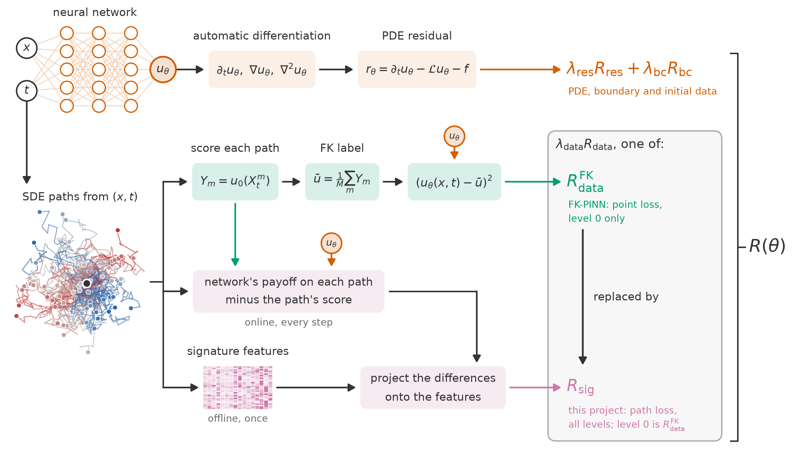
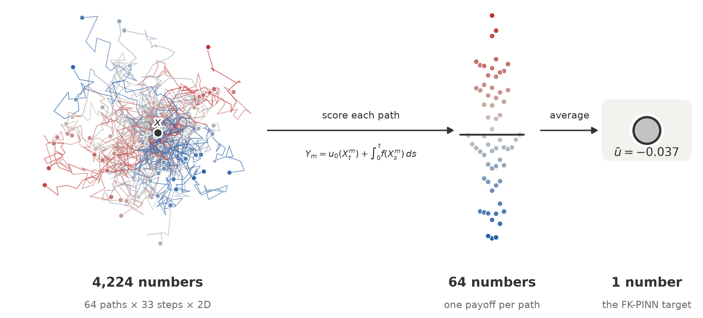

# Path-Enhanced FK-PINNs

**Stochastic physics-informed neural networks: Feynman–Kac path signatures for high-dimensional PDEs**

Federico Ganzer · IIB project, Department of Engineering, University of Cambridge

> [!NOTE]
> **Active work in progress.** This repository tracks ongoing research.

## Overview

Physics-informed neural networks (PINNs) solve PDEs without a mesh by penalising the PDE residual at sampled points (Raissi et al., 2019). Training on the residual inherits the conditioning of $`\mathcal{L}^*\mathcal{L}`$, which is set by the PDE operator, and often stalls (De Ryck et al., 2024). FK-PINNs (Tepakbong et al., 2026) add Monte Carlo point labels at a few collocation points, computed from the Feynman–Kac (FK) representation of the solution. These labels add an identity term to the loss metric, so convergence on that term is governed by the spectrum of the network's neural tangent kernel (NTK) (Jacot et al., 2018). That spectrum decays quickly (Rahaman et al., 2019), so high-frequency error still converges slowly.

The simulated paths behind each FK label also carry noisy but unbiased information about $`\nabla u, \nabla^2 u, \dots`$. Ordinary FK-PINNs discard it, because every path is reduced to a single number before averaging (Figure 2). This project supervises the network's derivatives as well as its values. The targets are the coefficients of the FK payoff in an orthogonal basis of **path signatures** (Chevyrev et al., 2026), computed on the paths already simulated for the FK labels. A path signature is the sequence of iterated integrals of a path (Chevyrev & Kormilitzin, 2016; Lyons & McLeod, 2024). Each level of the expansion is weighted by its Parseval norm, so the resulting loss, $`R_\mathrm{sig}`$, acts as a Sobolev-type preconditioner.

The code is a JAX implementation (Equinox, Optax, Signax).

<p align="center">
  
</p>

**Figure 1.** The training loss. Top: the PINN residual, computed by automatic differentiation. Middle: the FK-PINN data term, which regresses $`u_\theta`$ onto the Monte Carlo average $`\bar u`$ of the path payoffs. Bottom: this project's data term, $`R_\mathrm{sig}`$. On every path the network gives a model payoff $`Y^\theta_m`$; its residual against the data payoff $`Y_m`$ is projected onto orthogonal signature features $`\Phi_w`$ computed once, offline. $`R_\mathrm{sig}`$ replaces the FK point loss, which is its empty-word term.

## Problem setting

The current phase covers parabolic PDEs on $`\mathbb{R}^d\times(0,T]`$:

```math
\partial_t u = \mathcal{L}u + f, \qquad u(\cdot,0) = u_0, \qquad \mathcal{L} = b\cdot\nabla + \tfrac12\mathrm{tr}\big(\sigma\sigma^\top\nabla^2\big).
```

The FK representation is $`u(x,t) = \mathbb{E}[Y]`$ with payoff $`Y = u_0(X^x_t) + \int_0^t f(X_s)\thinspace ds`$, where $`dX = b(X)\thinspace dt + \sigma\thinspace dW`$ and $`X_0 = x`$. The source $`f`$ is zero except in the manufactured benchmark. An FK label at $`(x,t)`$ is the Monte Carlo average of $`Y`$ over $`M`$ Euler–Maruyama paths. The extension to elliptic problems, through exit-time payoffs, is deferred.

<p align="center">
  
</p>

**Figure 2.** How an FK label is formed. 64 paths of 33 steps in 2D (4,224 numbers) are each scored by the FK functional, giving 64 numbers. These are averaged into one label $`\bar u`$. Ordinary FK supervision keeps only this last number.

The network is trained on

```math
R(\theta) = \lambda_\mathrm{res}\int \lvert r_\theta\rvert^2\thinspace d\mu + \lambda_\mathrm{bc}R_\mathrm{bc}(\theta) + \lambda_\mathrm{data}R_\mathrm{data}(\theta),
```

where $`r_\theta`$ is the PDE residual of $`u_\theta`$, $`\mu`$ is the collocation measure, $`R_\mathrm{bc}`$ penalises the boundary and initial conditions, and $`R_\mathrm{data}`$ is a data term at the FK points. For an FK-PINN, $`R_\mathrm{data}`$ is the mean of $`(u_\theta(x_i,t_i) - \hat u_i)^2`$. The methods compared here differ only in $`R_\mathrm{data}`$.

## Why supervise derivatives

Write $`e = u_\theta - u`$ for the network's error. Around the current parameters, gradient-flow training is approximately $`\dot e = -K\mathcal{M}e + \epsilon`$. Here $`K`$ is the NTK integral operator, $`\mathcal{M}`$ is the metric operator of the loss, and $`\epsilon`$ is the forcing from label noise. If $`K`$ and $`\mathcal{M}`$ share Fourier modes, with eigenvalues $`g_\xi`$ and $`w_\xi`$ at frequency $`\xi`$, each error mode decays at rate $`g_\xi w_\xi`$. The condition number over the resolved band is then $`\kappa = \max_\xi g_\xi w_\xi / \min_\xi g_\xi w_\xi`$.

| Loss term | Metric $`\mathcal{M}`$ | Multiplier $`w_\xi`$ | Effect |
|---|---|---|---|
| FK point labels | $`I`$ | $`1`$ | $`\kappa = \kappa(K)`$, so spectral bias remains |
| Second-order PDE residual | $`\mathcal{L}^*\mathcal{L}`$ | $`\sim\lvert\xi\rvert^4`$ | Moves the stiffness to high frequencies |
| Derivative (Sobolev) labels | $`\sum_n \lambda_n(\nabla^n)^*\nabla^n`$ | $`\sum_n \lambda_n\lvert\xi\rvert^{2n}`$ | Well-chosen $`\lambda_n`$ flatten $`g_\xi w_\xi`$ |

Derivative supervision is Sobolev training (Czarnecki et al., 2017). The catch is noise. With noisy labels $`\hat u^{(n)} = \nabla^n u + \eta_n`$, the forcing is $`\epsilon = K\sum_n \lambda_n(\nabla^n)^*\eta_n`$, which weights the noise in mode $`\xi`$ by $`\lambda_n\lvert\xi\rvert^n`$. The weights that improve conditioning also amplify high-frequency label noise. The question is whether derivative labels from the FK paths are cheap and quiet enough to give the Sobolev gain, and which weights to use.

## Method: the path-signature residual

**Basis.** Let $`\hat W_s = (s, W_s)`$ be the driving Brownian motion augmented with time. A word $`w = i_1\cdots i_k`$ is a sequence of letters $`i_j\in\lbrace 0,1,\dots,d\rbrace`$, where $`0`$ stands for time and $`i`$ for $`W^i`$. Words ending in $`0`$ are dropped. Gram–Schmidt orthogonalisation of the time-augmented Itô signature gives an orthogonal polynomial basis $`\Phi_w = \langle\hat p_w, S(\hat W)_{0,t}\rangle`$ on path space, with $`\langle\hat p_w,\hat p_w\rangle = \mathbb{E}[\Phi_w^2]`$ (Chevyrev et al., 2026). Any square-integrable payoff then expands as

```math
Y = \sum_w \beta_w\Phi_w, \qquad \beta_w = \frac{\mathbb{E}[Y\Phi_w]}{\langle\hat p_w,\hat p_w\rangle}.
```

Each $`\beta_w`$ is a scalar expectation, estimated on the paths that already produce the FK label. For heat and Ornstein–Uhlenbeck problems the coefficients are derivatives of $`u`$ up to known constants. For heat, $`\beta_w = (2\nu)^{n/2}\partial_{i_1}\cdots\partial_{i_n}u(x,t)`$ for a word $`w = i_1\cdots i_n`$ without time letters (Stroock, 1987).

**Model payoff.** By Itô's formula, $`Y = u(x,t) + \int_0^t\nabla_\sigma u(X_s,t-s)\cdot dW_s`$ with $`\nabla_\sigma = \sigma^\top\nabla`$. Replacing $`u`$ by the network defines the model payoff and its coefficients:

```math
Y^\theta = u_\theta(x,t) + \int_0^t\nabla_\sigma u_\theta(X_s,t-s)\cdot dW_s, \qquad \beta^\theta_w = \frac{\mathbb{E}[Y^\theta\Phi_w]}{\langle\hat p_w,\hat p_w\rangle}.
```

**Loss.** Let $`W_N`$ be the set of words with at most $`N`$ non-zero letters and at most $`N_0`$ time letters. Level $`n`$, the words with exactly $`n`$ non-zero letters, spans the $`n`$-th Wiener chaos. The loss is the model's residual in chaos space, averaged over the FK points:

```math
R_\mathrm{sig} = \mathbb{E}\Big[\Big(\sum_{w\in W_N}\big(\beta^\theta_w - \beta_w\big)\Phi_w\Big)^2\Big] = \sum_{w\in W_N}\langle\hat p_w,\hat p_w\rangle\thinspace\delta\beta_w^2, \qquad \delta\beta_w = \frac{\mathbb{E}[(Y^\theta - Y)\Phi_w]}{\langle\hat p_w,\hat p_w\rangle}.
```

The empty word has $`\Phi_\emptyset = 1`$, so $`\delta\beta_\emptyset = e(x,t)`$: this is the FK point loss. The non-empty words have mean zero, so they see only the stochastic part of $`Y^\theta - Y = e(x,t) + \int_0^t\nabla_\sigma e(X_s,t-s)\cdot dW_s`$. Summed over all non-empty words, the Itô isometry gives

```math
\sum_{w\neq\emptyset}\langle\hat p_w,\hat p_w\rangle\thinspace\delta\beta_w^2 = \int_0^t \mathbb{E}\big[\lvert\nabla_\sigma e(X_s,t-s)\rvert^2\big]\thinspace ds .
```

The non-empty words therefore supervise the gradient of the network's error along every simulated path, at every intermediate time, without explicit gradient labels. For heat and Ornstein–Uhlenbeck problems, on the subspace where the network solves the PDE, $`R_\mathrm{sig}`$ equals the local derivative loss

```math
R_\mathrm{loc} = \sum_{n\le N}\frac{\tau(t)^n}{n!}\big\lVert\nabla^n u_\theta(x,t) - \nabla^n u(x,t)\big\rVert_F^2, \qquad \tau(t) = \begin{cases} 2\nu t, & \text{heat},\\ \nu\big(e^{2at}-1\big)/a, & \text{OU, } dX = -aX\thinspace dt + \sqrt{2\nu}\thinspace dW. \end{cases}
```

So $`R_\mathrm{sig}`$ is a pointwise Sobolev-type loss whose level weights are fixed by Parseval rather than tuned.

**Preconditioning.** The metric operators of the truncated losses are nested, $`I = \mathcal{M}_0 \preceq \mathcal{M}_N \preceq \mathcal{M}_\infty = e^{-2t\mathcal{L}}`$. For heat, $`\mathcal{M}_N`$ is the multiplier $`w_N(\lambda) = \sum_{n\le N}(2t\lambda)^n/n!`$ with $`\lambda = \nu\lvert\xi\rvert^2`$. Suppose, as an idealisation, that the NTK shares these modes with eigenvalues $`g(\lambda)`$, decreasing with roughness. If $`g\thinspace w_N`$ stays non-increasing on the trained band $`\lambda\le\lambda_{\max}`$, then, per time slice,

```math
\kappa(K\mathcal{M}_N) = \frac{\kappa(K)}{w_N(\lambda_{\max})}.
```

If $`w_N`$ grows faster than $`g`$ decays, a large $`N`$ makes $`\kappa`$ worse. The truncation level is the order of the preconditioner. Whether a finite $`N`$ lowers $`\kappa`$ for a real network is what the experiments test.

**Estimator.** At one FK point, path $`i`$ gives $`Y_i`$, the features $`\Phi^{(i)}_w`$ and the model payoff $`Y^\theta_i`$, with the Itô integral replaced by its Euler sum. At the solution, $`Y^\theta_i = Y_i`$ on every path up to time discretisation, so estimating $`\delta\beta_w`$ from $`Y^\theta - Y`$ on the same paths cancels the label noise. The default estimator of $`R_\mathrm{sig}`$ is a U-statistic over pairs of paths, unbiased at every $`\theta`$ (Hoeffding, 1948). The plug-in square of the mean is available as an ablation. Each optimiser step samples a batch of FK points and paths. Optional Horvitz–Thompson subsampling of time steps (Horvitz & Thompson, 1952) keeps the estimate unbiased at lower cost. Its variance grows quickly with block size, so it is only used on configurations that pass a pre-training check of how well the same-path cancellation works. Network derivatives use forward and Taylor mode (Bettencourt et al., 2019) rather than nested reverse mode.

## Experiments

### Hypotheses

The current phase tests two hypotheses, in order. The first is a cheap gate that needs only local derivatives. The second needs the path machinery and runs only if the first holds.

- **H1. Path supervision conditions training.** With noise-free targets, replacing the FK point loss by $`R_\mathrm{sig}`$, in its local form $`R_\mathrm{loc}`$, lowers $`\kappa(K\mathcal{M})`$ and the error at matched steps. The gain grows with $`w_N(\lambda_{\max})`$, that is with the roughness of $`u`$, the horizon $`T`$ and the level $`N`$, until $`g\thinspace w_N`$ turns upward.
- **H2. The signature estimator adds value.** $`R_\mathrm{sig}`$ beats estimators that supply the same information without signatures: (a) a derivative loss on Monte Carlo pathwise derivatives, and (b) the untruncated path residual.

Later hypotheses, on whether Parseval weights match tuned weights and whether Monte Carlo targets keep the noise-free gain, follow once these hold.

### Losses and targets

Every run uses the same PINN residual and boundary and initial terms. The loss weights are tuned once per benchmark, with exact point labels, and then shared. Runs differ only in the data term at the FK points. The code currently supports:

| Data term | Targets |
|---|---|
| None | Plain PINN |
| Point loss, $`(u_\theta - \text{label})^2`$ | Exact solution values, or Monte Carlo FK labels |
| Local derivative loss, $`\sum_{n\le N} w_n\lVert\nabla^n u_\theta - \text{label}_n\rVert_F^2`$ | Exact derivatives with Parseval weights $`w_n = \tau(t)^n/n!`$; exact derivatives with tuned weights ($`\lambda_n`$ or $`\lambda_n t^n`$); or Monte Carlo pathwise derivatives $`\nabla^n u_0(X_t)`$, with the flow Jacobian and Parseval weights |
| $`R_\mathrm{sig}`$ | Monte Carlo, from $`Y^\theta - Y`$ on the same paths; or $`\hat\beta_w`$ precomputed offline, with $`\beta^\theta_w`$ on fresh paths each step |
| Untruncated path residual, $`\mathbb{E}[(Y^\theta - Y)^2]`$ | Monte Carlo, same paths |

How they test the hypotheses:

- **H1** compares the local derivative loss on exact derivatives with Parseval weights (the noise-free form of $`R_\mathrm{sig}`$) against the point loss on exact labels. The comparison is swept over frequency, horizon $`T`$ and level $`N\in\lbrace 1,2,3\rbrace`$. Exact targets separate conditioning from label noise. $`\kappa`$ is measured at checkpoints from the Gauss–Newton matrix of the data term, per time slice.
- **H2a** compares $`R_\mathrm{sig}`$ on the same paths against the local derivative loss on Monte Carlo pathwise derivatives, the approach of differential machine learning (Huge & Savine, 2020).
- **H2b** compares $`R_\mathrm{sig}`$ against the untruncated path residual, which fits the martingale representation path by path as FBSNN and deep BSDE solvers do (Raissi, 2018; Han et al., 2018).
- Both H2 comparisons are read against the point loss on Monte Carlo labels, the published FK-PINN. If $`R_\mathrm{sig}`$ does no better than that baseline, H2 is uninformative.
- The tuned-weight derivative loss and the offline $`R_\mathrm{sig}`$ target are for the later hypotheses. The plain PINN gives context.

### Benchmarks

The three benchmarks are parabolic with closed-form solutions, so exact targets are available for each. They are ordered by how far they depart from the setting of the theory: an endpoint payoff, a fixed horizon, and a generator that commutes with $`\nabla_\sigma`$.

- **Heat** ([problems/heat.py](src/pathenhancedfkpinn/problems/heat.py)): $`\partial_t u = \nu\Delta u`$ with $`u_0 = \prod_i\sin(k\pi x_i)`$ on $`[-1,1]^d`$. Its signature coefficients are known in closed form, so it checks the hierarchy and Stroock's formula end to end. It is a unit test, not evidence for the hypotheses. It also hosts the parity check against the PyTorch code.
- **Manufactured** ([problems/manufactured.py](src/pathenhancedfkpinn/problems/manufactured.py)): $`u^* = \sin\pi x + \varepsilon\sin k\pi x`$ in $`d = 1`$, held fixed in time by a source term (a two-mode heat variant is also available). Sweeping $`k\in\lbrace 1,4,16\rbrace`$ and $`T`$ directly tests the predicted scaling of the gain with $`w_N(\lambda_{\max})`$, where $`\lambda_{\max} = \nu(k\pi)^2`$. This is the main benchmark for H1, and is then used for H2.
- **Ornstein–Uhlenbeck** ([problems/ou.py](src/pathenhancedfkpinn/problems/ou.py)): $`dX = -aX\thinspace dt + \sqrt{2\nu}\thinspace dW`$ with $`u_0 = \prod_i\sin(\pi x_i)`$, $`d\in\lbrace 1,2\rbrace`$, solved in closed form by Mehler's formula. The linear drift makes time-letter words non-zero, so the time truncation $`N_0`$ matters, and pathwise derivatives need the flow Jacobian. Used for H1 and H2.

The elliptic benchmarks of Tepakbong et al. (2026), Poisson, mean exit time and committor, need the exit-time extension and come later.

## Repository layout

```
src/pathenhancedfkpinn/
  problems/        parabolic problems: heat, manufactured, Ornstein–Uhlenbeck
  sde/             Euler–Maruyama FK path simulation
  signature/       word sets, exact Itô inner products and orthogonal basis, Itô signature features
  payoff/          data payoff Y, model payoff Y^theta, Horvitz–Thompson time subsampling
  fkdata.py        offline FK dataset per seed: paths, payoffs, features, labels
  nets.py          tanh MLP (Equinox), float32 parameters
  derivs.py        derivatives of the network: autodiff, Taylor mode, Laplacian
  losses/          PINN terms, point loss, local derivative loss, R_sig, path residual
  train.py         training loop, evaluation, condition-number checkpoints, resume
  diagnostics/     Gauss–Newton spectrum, cancellation map
  config.py        config layering and hashing
  sweep.py         run specs: layers, overrides, grid, seeds
  keys.py          counter-based random keys
  precision.py     float64 / float32 policy
configs/           base.yaml and per-benchmark layers
scripts/           run.py, submit.py (Slurm), diagnostics.py, check_gpu.py, presentation_figures.py
slurm/             sbatch template and example cluster config
tests/             fast and slow (full Monte Carlo size) test suites
experiments_proposals/   experiment proposal (LaTeX)
paper/             paper draft
figures/           figures for presentations and the paper
```


## References

- Bettencourt, J., Johnson, M. J. & Duvenaud, D. (2019). Taylor-mode automatic differentiation for higher-order derivatives in JAX. *NeurIPS 2019 Workshop on Program Transformations for Machine Learning*.
- Chevyrev, I., Ferrucci, E., Lee, D., Lyons, T., Oberhauser, H. & Tapia, N. (2026). Orthogonal polynomials on path-space. [arXiv:2602.18808](https://arxiv.org/abs/2602.18808).
- Chevyrev, I. & Kormilitzin, A. (2016). A primer on the signature method in machine learning. [arXiv:1603.03788](https://arxiv.org/abs/1603.03788).
- Czarnecki, W. M., Osindero, S., Jaderberg, M., Świrszcz, G. & Pascanu, R. (2017). Sobolev training for neural networks. *Advances in Neural Information Processing Systems (NeurIPS)*.
- De Ryck, T., Bonnet, F., Mishra, S. & de Bézenac, E. (2024). An operator preconditioning perspective on training in physics-informed machine learning. *International Conference on Learning Representations (ICLR)*.
- Han, J., Jentzen, A. & E, W. (2018). Solving high-dimensional partial differential equations using deep learning. *Proceedings of the National Academy of Sciences*, 115(34), 8505–8510. [arXiv:1707.02568](https://arxiv.org/abs/1707.02568).
- Hoeffding, W. (1948). A class of statistics with asymptotically normal distribution. *Annals of Mathematical Statistics*, 19(3), 293–325.
- Horvitz, D. G. & Thompson, D. J. (1952). A generalization of sampling without replacement from a finite universe. *Journal of the American Statistical Association*, 47(260), 663–685.
- Huge, B. & Savine, A. (2020). Differential machine learning. [arXiv:2005.02347](https://arxiv.org/abs/2005.02347).
- Jacot, A., Gabriel, F. & Hongler, C. (2018). Neural tangent kernel: convergence and generalization in neural networks. *Advances in Neural Information Processing Systems (NeurIPS)*.
- Lyons, T. & McLeod, A. D. (2024). Signature methods in machine learning. [arXiv:2206.14674](https://arxiv.org/abs/2206.14674).
- Rahaman, N., Baratin, A., Arpit, D., Draxler, F., Lin, M., Hamprecht, F. A., Bengio, Y. & Courville, A. (2019). On the spectral bias of neural networks. [arXiv:1806.08734](https://arxiv.org/abs/1806.08734).
- Raissi, M. (2018). Forward–backward stochastic neural networks: deep learning of high-dimensional partial differential equations. [arXiv:1804.07010](https://arxiv.org/abs/1804.07010).
- Raissi, M., Perdikaris, P. & Karniadakis, G. E. (2019). Physics-informed neural networks: a deep learning framework for solving forward and inverse problems involving nonlinear partial differential equations. *Journal of Computational Physics*, 378, 686–707.
- Stroock, D. W. (1987). Homogeneous chaos revisited. *Séminaire de Probabilités XXI*, Lecture Notes in Mathematics 1247, 1–7. Springer.
- Tepakbong, N., Hu, H., Liu, C. & Zhou, X. (2026). Taming the loss landscape of PINNs with noisy Feynman–Kac supervision: operator preconditioning and non-asymptotic error bounds. *Proceedings of the 43rd International Conference on Machine Learning (ICML)*, PMLR 306. [arXiv:2606.00643](https://arxiv.org/abs/2606.00643).
